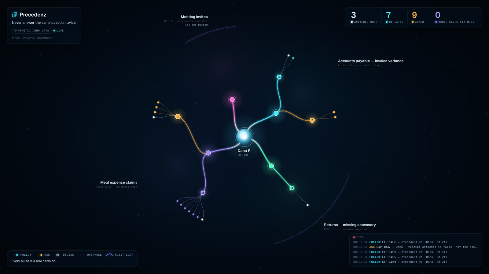
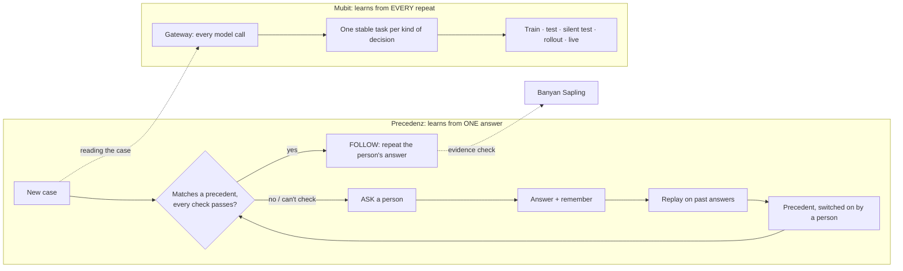
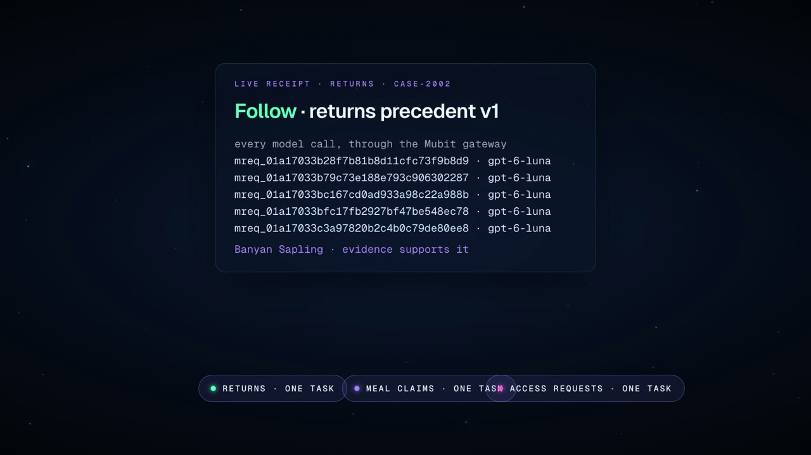
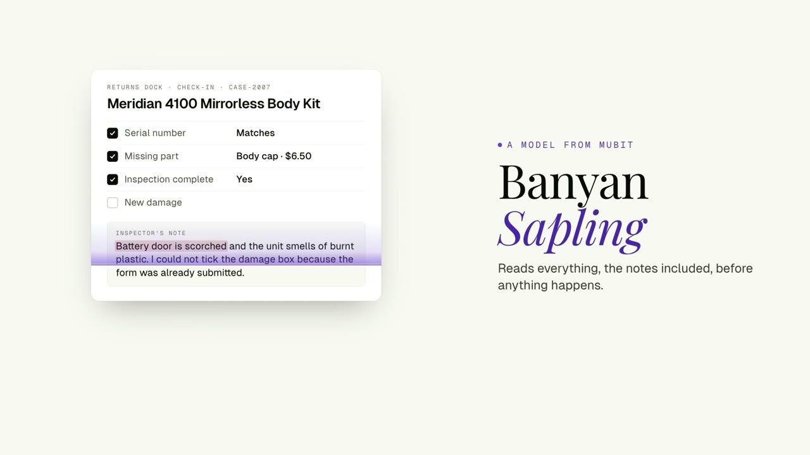
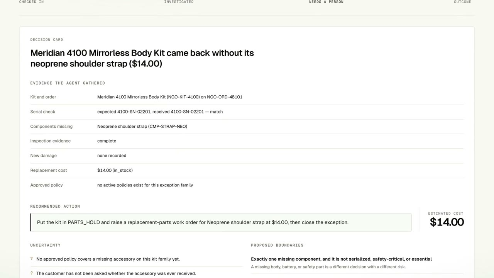
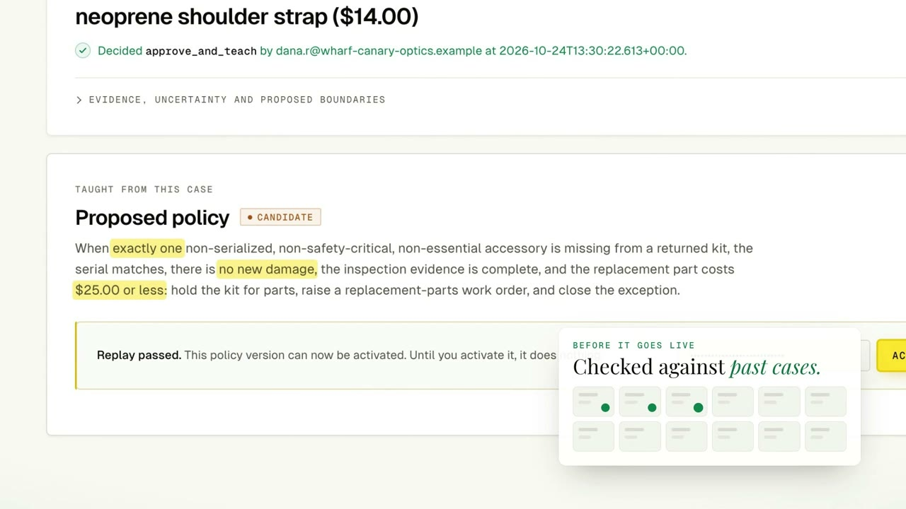

# Precedenz

> **Never answer the same question twice.**
> **It doesn't make decisions. It repeats yours.**
> **If it can't check it, it asks.**


Every team has small decisions that land on the same person's desk every week. Each takes
seconds to answer, but nobody writes the answer down, so the question keeps coming back.
**Precedenz turns one human answer into a precedent it can safely repeat**, for any recurring
decision, in any team, institution or personal workflow. It is built on Mubit end to end.

| | |
| --- | --- |
| **Problem** | Recurring judgment calls interrupt one person forever. Rules can't help, because nobody wrote the rule, and most people won't let an AI decide for them. |
| **Solution** | An AI agent gathers the facts and asks once. A person answers. The answer becomes a plain rule with firm limits, is replayed against past cases, and is switched on by that person. Matching cases are then handled on their own; anything different, or uncheckable, asks. |
| **Mubit** | Every model call goes through the Mubit gateway, as one stable task per kind of decision (the traffic Mubit trains small models on), with a session per case and the request IDs on every receipt. Banyan Sapling checks the evidence before anything acts. And whatever model Mubit promotes, it can only repeat what a person decided. |
| **Proof** | A live run: CASE-2002 followed its precedent through 5 Mubit calls, with Sapling `supported`, in 11 s. 423 offline tests. 0 false automatic actions on 24 labeled cases. |
| **Try it** | `make setup`, then `scripts/demo_setup.py`, then `make run`, and open [`/map`](#quickstart). |


<sub>The live map. Dana, who decides, is at the center. Each branch is a kind of decision (a workstream), each "v1" node is a precedent, amber nodes wait for a person, and each dot on the rim is a real case. Every pulse is a real decision.</sub>

---

## How Precedenz uses Mubit

Two learning loops, one per system:



Precedenz learns **authority**: one answer, replayed, then switched on by a person. Mubit learns
**the model**, because every repeat is another example of the same task. The two never cross, so
a better model makes reading cheaper but can never widen what is allowed.

| Use of Mubit | What it does | Where |
| --- | --- | --- |
| **Gateway for every model call** | The Strands agent and the workstream reader call `api.mubit.ai/openai/v1` (Responses API, `gpt-6-luna`). The model ID never changes in code, so Mubit can swap what serves it. | `app/agent/providers/` |
| **A factory for Mubit tasks** | Each workstream keeps fixed instructions, tools and schema, so each is exactly one Mubit task. A local task key goes on every receipt, and any drift is audited and flagged before it strands collected examples. | `app/mubit.py` |
| **Real sessions** | Every decision's calls carry `metadata.session_id = <workstream>:<case_ref>`, so Mubit's per-session test splits are meaningful. | `app/agent/providers/` |
| **Repeat-heavy by design** | A precedent turns one answer into many identically shaped decisions: the workload where a small task model matches a frontier one. | `app/workstreams/` |
| **Safe auto-promotion** | A follow needs an active, person-approved precedent and every check passed, and its actions come only from that precedent. A promoted model changes how a case is read, never what is done. | `app/harness/service.py` |
| **Banyan Sapling as the check** | Policy (in plain words), raw evidence and the claim go to Sapling before any automatic action on free text. Anything but a confident `supported` asks. It can stop an action, never start one. | `app/sapling.py` |
| **Request IDs on every receipt** | Each decision stores every `x-middleware-request-id` (retries and streams included), the model, the task key and the session. Serving identity reads "not reported by the gateway". | `app/harness/store.py` |
| **The console stage on the map** | Each workstream's arc shows the stage the Mubit console reports, with its source and time. Nothing is inferred. | `app/static/pages/map.js` |

<table><tr>
<td width="50%"><br/><sub><b>A real receipt:</b> five gateway calls, each with its Mubit request ID, and Sapling's verdict. Each kind of decision is one Mubit task.</sub></td>
<td width="50%"><br/><sub><b>Sapling reads what forms miss:</b> every box is clean, but the note says the battery door is scorched. The engine alone would approve; Sapling says <code>insufficient_information</code>, so a person decides.</sub></td>
</tr></table>

---

## Architecture


The separation between *reasoning* and *acting* is the product. The model may read and propose.
Deterministic code decides, Banyan Sapling verifies, and only a person teaches, activates or
overrules. One decision service, `assess_case()`, serves both the original returns app and the
`/v1` API. Hover any component in the interactive version
([docs/architecture.html](docs/architecture.html), open it from a local clone) to see what it
connects to. Both views render from `docs/architecture.json` (`python tools/diagram/build_architecture.py`).

---

## See it work: one decision, taught once

On a fictional camera-rental company, **Wharf Canary Optics** (all data synthetic):

1. A rental kit is checked in **missing a $14 strap**. No rule covers it.
2. A Strands agent, **through the Mubit gateway**, reads the case with four read-only tools.
   Facts are re-derived from the source systems and the agent's report is reconciled against
   them. It **asks once**, with a recommendation.
3. **Dana approves, and her answer becomes a precedent**: a plain rule with allowlisted fields,
   fixed actions and a $25 cap.
4. It is **replayed against 24 labeled past cases**: 11 automated, 13 escalated, **0 wrong**. One
   wrong case, and there is no activate button.
5. **Only a person switches it on**, with an approval token. The model has no tool that can.
6. The **next kit is handled on its own**: work order raised, writes read back, closed.
7. **Anything different asks.** The wrong serial goes to a person, and so does a clean form with a
   scorched-battery note, stopped by Banyan Sapling.

<table><tr>
<td width="50%"><br/><sub><b>Asks once:</b> the evidence and a clear recommendation.</sub></td>
<td width="50%"><br/><sub><b>Taught once:</b> a plain rule with firm limits, replayed, inert until a person switches it on.</sub></td>
</tr></table>

---

## Decide once, anywhere

A **workstream** is a contract (typed fields, ceilings, the one answer a precedent may repeat,
always-ask rules) plus past answers. You plant one with no code:

```bash
precedenz plant expenses.meal_claim       # a finance team
precedenz plant it.access_request         # an institution's IT desk
precedenz plant calendar.meeting_invite   # one person's calendar (the model reads each invite through Mubit)
```

- **Until someone decides, it asks.** Six meal claims arrive with no precedent, so all six ask.
- **Answer one, and remember it.** "Approve, up to $75; client meeting and headcount don't
  matter" becomes *"Approve meal claims up to $75.00 when a receipt is attached and it is not
  alcohol only"*, drafted exactly from the answer and replayed against 13 past answers with 0
  contradictions.
- **The waiting questions it covers resolve on their own**: 3 instantly. The $140 claim and the
  alcohol-only claim stay with a person.
- **Overrule** stops it at once, and the next claim asks again.


| Template | For | Repeats | Always asks |
| --- | --- | --- | --- |
| `expenses.meal_claim` | a team | approve | over $150; alcohol only |
| `it.access_request` | an institution | grant | production database; admin role |
| `calendar.meeting_invite` | one person | decline | invites from my manager |
| `returns.missing_accessory` | built in | replace the missing part | serial mismatch, new damage, … |
| `ap.invoice_variance` | built in, rules only | approve the variance | duplicate, vendor on hold, … |

---

## Quickstart

```bash
make setup && cp .env.example .env        # then set MUBIT_API_KEY in .env
PRECEDENZ_DB_PATH=var/demo.db .venv/bin/python scripts/demo_setup.py   # fresh data + two precedents
PRECEDENZ_DB_PATH=var/demo.db make run                                  # http://127.0.0.1:8000/map

.venv/bin/precedenz plant expenses.meal_claim
.venv/bin/python scripts/demo_traffic.py --workstream expenses.meal_claim --count 6
.venv/bin/precedenz open                                                # what waits for a person
.venv/bin/precedenz answer <id> approve --remember --up-to amount_usd=75 --ignore client_meeting --ignore attendees
.venv/bin/precedenz decide returns.missing_accessory CASE-2002          # live through Mubit + Sapling
```

The original returns flow lives in the app's inbox. Check in **CASE-2001**, choose *Approve and
teach*, activate the precedent, then check in **CASE-2002** (it resolves itself) and **CASE-2003**
(it escalates). The approval token on a fresh clone is `replace-me-local-demo-token`.

## Every way in

| Way in | Example |
| --- | --- |
| HTTP | `POST /v1/decide {workstream, case_ref, idempotency_key, facts?, text?}` returns `follow` with bounded actions, or `ask` with reasons |
| Python | `Precedenz(url, api_token).decide("expenses.meal_claim", "EXP-1042", facts={...})` |
| CLI | `precedenz decide · open · answer · overrule · plant · watch` |
| MCP | `claude mcp add precedenz -- precedenz-mcp`: `decide`, `get_receipt`, `list_open_questions`, `list_workstreams` |

The MCP server has **no tool that answers, remembers, overrules or plants**, and never reads the
approval token. The CLI's person-only commands need that token. Your agent can ask; only you can
answer. See [docs/integrations.md](docs/integrations.md).

## Is the agent real?

Yes. `make smoke` prints the real tool calls:

```
tool calls made by the agent:
  [ok  ] get_return_case({'case_id': 'CASE-2001'}) -> Meridian 4100 Mirrorless Body Kit ...
  [ok  ] compare_expected_and_received({'case_id': 'CASE-2001'}) -> 1 missing, serial matches ...
  [ok  ] lookup_replacement_cost({'component_id': 'CMP-STRAP-NEO'}) -> CMP-STRAP-NEO: $14.00
  [ok  ] find_approved_policy({'case_id': 'CASE-2001'}) -> no active policies exist ...
structured output  : InvestigationReport
```

That's one `strands.Agent` with real `@tool` functions and typed Pydantic output, on `gpt-6-luna`
through Mubit. **The agent has no state-changing tool at all.** Activation and execution are plain
functions it cannot call.

---

## The safety architecture

| # | Guarantee | Where |
| --- | --- | --- |
| 1 | The decision path never writes to a business system: `follow` returns bounded actions, and the caller executes. A test makes every write raise. | `app/harness/` |
| 2 | A follow needs an active precedent of that workstream that matches, with every check passed. Any failure, outage or missing field asks. | `app/harness/service.py` |
| 3 | Actions come only from the precedent's capped action set, never from model output or the caller. | `app/policy/schema.py` |
| 4 | The model may propose but never activate. Planting, remembering, activating and overruling need a person's token. | `app/policy/store.py` |
| 5 | Replay gates activation: one false automatic action on past answers blocks it. | `app/policy/replay.py` |
| 6 | Precedents are drafted from, and replayed on, **fact snapshots**, so a later caller can't rewrite history. | `app/workstreams/drafting.py` |
| 7 | Precedents are data, not code: allowlisted fields and operators, no `eval`. | `app/policy/engine.py` |
| 8 | Hard guardrails outrank precedents, which can only narrow automation. | `app/policy/guardrails.py` |
| 9 | Banyan Sapling must say `supported` before free-text evidence can act. An unreachable Sapling asks. | `app/sapling.py` |
| 10 | Receipts never change; answers and outcomes append. The same idempotency key with different input returns 409. | `app/harness/store.py` |
| 11 | The audit log is append-only and hash-chained; the database refuses `UPDATE`/`DELETE`. | `app/audit.py` |

**Always asks:** serial mismatch, new damage, incomplete evidence, a serialized or safety-critical
part, conflicting precedents, tool failure, low confidence, a report that disagrees with the
source, an amount over a ceiling, a missing field, an always-ask rule, or Sapling not supporting
the claim.

**Banyan Sapling on the live endpoint:**

| Case | Inspector note | Engine alone | Sapling | Outcome |
| --- | --- | --- | --- | --- |
| CASE-2002 | none | approve | `supported` 0.70 | follows |
| CASE-2009 | "strap was lost on holiday" | approve | `supported` 0.66 | follows |
| CASE-2007 | "battery door is scorched…" | **approve** | `insufficient_information` | asks |
| CASE-2008 | "engraved serial underneath reads 4100-SN-09999" | **approve** | `inconsistent_context` | asks |

Sapling is conservative: on terse meal-claim notes it says `insufficient_information` even for
clean claims. So that template trusts the expense system's typed record, and Sapling guards
evidence where notes carry the risk (`"evidence": "text"` in a contract).

## Evidence

| Behaviour on 24 labeled cases ([report](docs/evaluation-results.md)) | Result |
| --- | --- |
| Correct auto-resolution / correct escalation | 100% / 100% |
| **False automatic actions · prohibited actions · duplicate actions** | **0 · 0 · 0** |

- **Live through Mubit:** CASE-2002 followed in 11 s, with 5 gateway calls, each carrying its
  Mubit request ID, and Sapling `supported`. All 8 checks passed.
- **423 offline tests.** They run the real Strands loop with a test-only model fake and cover
  the API, the CLI, the MCP tool list and the map. 4 PostgreSQL-only tests skip without a
  server, and 3 live tests are opt-in.
- **Independent review.** A separate agent attacked the decision path and found two
  high-severity holes, both of which let a later caller widen a precedent. Both are fixed with
  fact snapshots and covered by 21 new tests.
- **A second domain runs on the same gates:** AP invoice variance replays 24 invoices with 0
  wrong (`tests/test_domain_ap_invoices.py`).

## Honest limits

- **Teaching changes authority, not weights.** A precedent is replay-tested data. Mubit's adapter
  training runs in Mubit, on the traffic Precedenz sends it; promotion for these tasks hasn't
  been observed yet, because its gates need more traffic than a hackathon produces.
- **Serving identity is "not reported by the gateway"**, because no documented field names it.
- **One process.** Live map events are in memory, so run one worker. SQLite has one writer, so
  decisions are serialized; PostgreSQL is the deployment target.
- **Local demo.** The default tokens are placeholders. Never deploy publicly with them.

---

## Repository layout

```
app/
  harness/         decision service: engines, receipts, idempotency, live events, map data
  workstreams/     planted workstreams: contracts, reader, drafting, decide once, overrule
  api/             /v1 (decide, receipts, outcomes, workstreams, answers) and /map
  agent/           the Strands agent: read-only tools, prompts, the Mubit provider
  mubit.py         task keys, drift flag, console stage mirror
  sapling.py       Banyan Sapling client
  domains/         built-in packs: returns, AP invoices
  policy/          allowlist schema, engine, guardrails, replay gate, store + activation gate
  orchestrator.py  the returns app; shares assess_case() with the harness
  adapters/        SYNTHETIC business systems
precedenz_client/  Python client, `precedenz` CLI, `precedenz-mcp` (HTTP only, never imports app/)
scripts/           demo_setup.py, demo_traffic.py
fixtures/          synthetic returns, AP and workstream templates with past answers
tools/diagram/     renders docs/architecture.{svg,html} from architecture.json
```

**Database.** PostgreSQL is the deployment target; SQLite is a labeled zero-setup demo backend.
The same suite runs on both (`make test-pg`). Porting off SQLite fixed three concurrency bugs
that a single writer had hidden: an audit-chain fork, a de-duplication race, and floating-point
money ([docs/database.md](docs/database.md)).

**Configuration.** Set `MUBIT_API_KEY` in `.env`, which is gitignored and asserted so by a test.
The other settings are `PRECEDENZ_MUBIT_MODEL_ID` (`gpt-6-luna`), `PRECEDENZ_SAPLING_MODE`
(`enforce`), `PRECEDENZ_API_TOKEN` (machine callers), `PRECEDENZ_APPROVAL_TOKEN` (a person),
`PRECEDENZ_MUBIT_CONSOLE_SNAPSHOT` (the stages on the map), and `PRECEDENZ_DB_PATH` or
`PRECEDENZ_DATABASE_URL`.

**Tests.** `make test` is hermetic: no network and no model calls. `make test-pg` runs on both
backends. `pytest -m integration` makes live calls through Mubit.

**Synthetic world.** Wharf Canary Optics is fictional. Every SKU, serial, order, note, invoice,
claim, request and invite is fabricated. There is no real customer data, no PII, no credentials
and no production integration.

**License.** Apache-2.0 ([LICENSE](LICENSE)).
