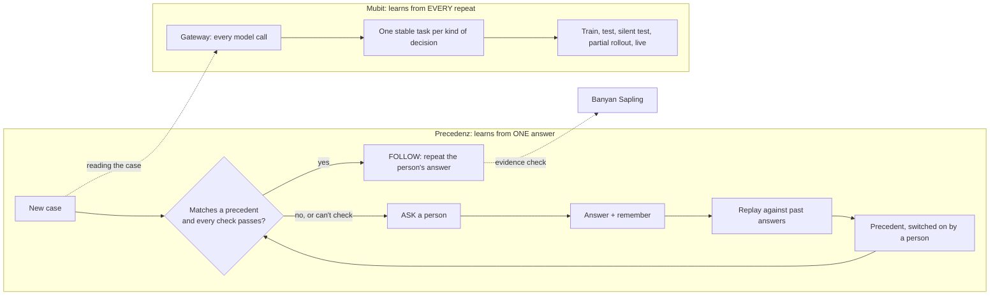
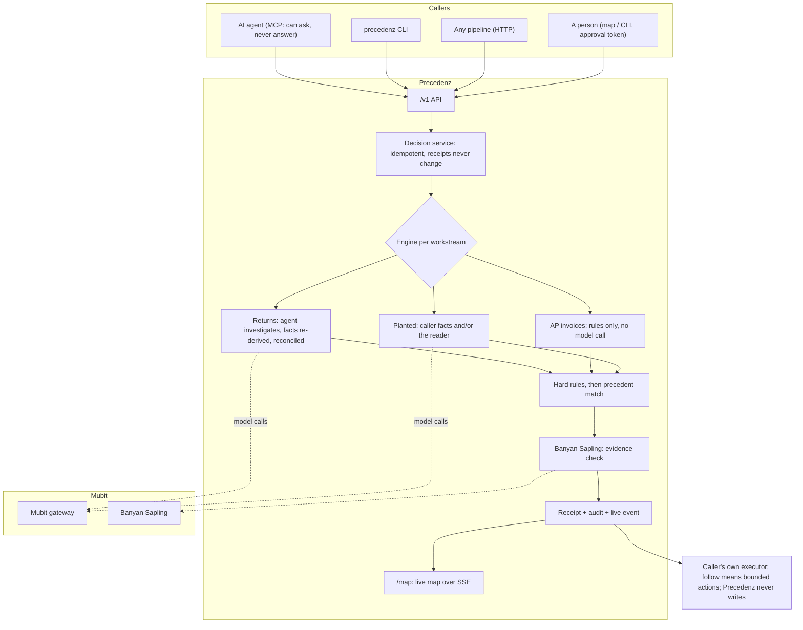

# Precedenz

> **Never answer the same question twice.**
> **It doesn't make decisions. It repeats yours.**
> **If it can't check it, it asks.**

Every team has small decisions that land on the same person's desk every week. Each one
takes seconds to answer, but nobody ever writes the answer down, so the same question keeps
coming back. Rule-based automation can't help, because nobody wrote the rule. And most people
won't let an AI decide for them.

**Precedenz turns one human answer into a precedent it can safely repeat.** An AI agent
gathers the facts and asks once. A person answers. That answer becomes a plain rule with firm
limits, is replayed against past cases, and only goes live when a person switches it on. From
then on, every matching case is handled on its own; anything that differs, or that can't be
checked, goes back to a person. It works for any recurring decision: a returns desk, a finance
team, an institution, or one person and their own calendar.

**Built on Mubit, end to end.** Every model call goes through the
[Mubit](https://mubit.ai) gateway. Each kind of decision becomes exactly one clean, repeating
Mubit task, which is the traffic Mubit trains smaller task models on. Every automatic action is
first checked by **Banyan Sapling**, Mubit's verification model. And whatever model Mubit
serves next, it can only ever repeat what a person decided.


*The live map (`/map`). Dana, the person who decides, is at the center. The four branches are
workstreams (returns, accounts payable, meal claims, meeting invites). On each branch, a "v1" node is a
precedent and the amber nodes are questions waiting for a person; every dot on the rim is a real case.
Every pulse is a real decision.*

---

## Contents

- [How Precedenz uses Mubit](#how-precedenz-uses-mubit)
- [See it work: one decision, taught once](#see-it-work-one-decision-taught-once)
- [Decide once, anywhere](#decide-once-anywhere)
- [Architecture](#architecture)
- [Quickstart](#quickstart)
- [Every way in](#every-way-in)
- [The safety architecture](#the-safety-architecture)
- [Evidence](#evidence)
- [Honest limits](#honest-limits)
- [Repository layout](#repository-layout) · [Database](#database) · [Configuration](#configuration) · [Tests](#tests)

---

## How Precedenz uses Mubit

Precedenz runs two learning loops, and each one belongs to a different system:



Precedenz learns at the level of **authority**: one human answer, replayed, activated by a
person, instantly. Mubit learns at the level of **the model**: every repeat is a well-formed
example of the same task, and Mubit can train and promote a smaller model for it over time.
The two never cross. A better model makes reading the case faster and cheaper; it can never widen what is allowed.

| # | How Mubit is used | Why it matters | Where |
| --- | --- | --- | --- |
| 1 | **The Mubit gateway is the model path.** The Strands agent and the workstream reader call `https://api.mubit.ai/openai/v1` (OpenAI Responses API, `gpt-6-luna`) with a Mubit key. The model ID never changes in code, so Mubit can swap what serves it. | In the default configuration there is no direct provider path: every LLM call is routed through Mubit and recorded there. | `app/agent/providers/__init__.py` |
| 2 | **Precedenz produces Mubit tasks.** Each workstream has fixed instructions, tools and output schema, so it is exactly one Mubit task. A local *task key* (a hash of model, instructions and tool specs) goes on every receipt; if it ever drifts, the change is written to the audit log and flagged in the map data, before a prompt edit can strand collected examples. | Organizations get clean, single-purpose adapter traffic without anyone learning what a task fingerprint is. | `app/mubit.py`, `app/agent/build.py` |
| 3 | **Real sessions.** Every decision's model calls carry `metadata.session_id = <workstream>:<case_ref>`, so one case's calls group into one Mubit session. | Mubit splits test cases by session; genuine sessions make its quality gates meaningful. | `app/agent/providers/__init__.py` |
| 4 | **Repeat-heavy traffic.** Once a person decides, a precedent turns one answer into many identically shaped decisions. | This is the workload where a small task-specific model can match a frontier model. Precedenz makes that traffic on purpose. | `app/workstreams/`, `app/harness/` |
| 5 | **A guarantee that makes automatic promotion safe.** A follow needs an active, person-approved precedent and every check passed, and its actions come only from that precedent. Whatever model Mubit promotes changes how the case is *read*, never what may be *done*. | Risk teams can leave Mubit's automatic promotion on. | `app/harness/service.py` |
| 6 | **Banyan Sapling checks the evidence.** Before any automatic action on free-text evidence, Sapling gets the policy in plain words, the raw evidence (inspector notes included) and the claim. Anything but a confident `supported` sends the case to a person. It can stop an action, never start one. | Forms don't tell the whole story: the policy engine reads fields, while Sapling reads what the fields miss. | `app/sapling.py`, `app/orchestrator.py`, `app/workstreams/engine.py` |
| 7 | **Every receipt names its gateway calls.** Each decision records every Mubit `x-middleware-request-id` (one per HTTP call, retries and streams included), the requested model, the task key and the session. Serving identity reads "not reported by the gateway", because Mubit documents no such field and we don't guess. | Any business decision traces straight to its calls in the Mubit console. | `app/harness/store.py`, `/map/receipt/{id}` |
| 8 | **The Mubit stage on the map.** Each workstream's arc on the map shows the stage the Mubit console reports (Collecting examples … Live), with its source and time. It is display only; nothing is inferred. | People see both loops in one place: what was decided, and how the model behind it is maturing. | `app/mubit.py::console_stage`, `app/static/pages/map.js` |

<table>
<tr>
<td width="50%"><br/><sub><b>A real receipt.</b> CASE-2002 followed Dana's precedent. All five model calls went through the Mubit gateway, each with its own request ID, and Banyan Sapling confirmed the evidence. Each kind of decision is one Mubit task.</sub></td>
<td width="50%"><br/><sub><b>Banyan Sapling reads what the form misses.</b> Every box is clean, but the inspector wrote that the battery door is scorched. The policy engine alone would approve; Sapling answers <code>insufficient_information</code>, so a person decides.</sub></td>
</tr>
</table>

---

## See it work: one decision, taught once

The worked example runs on a fictional camera-rental company, **Wharf Canary Optics**. All its
data is synthetic.

1. **A question arrives as an event.** A rental kit is checked in at the returns dock missing a
   $14 neoprene strap. No rule covers it.
2. **The agent gathers the facts and asks once.** A Strands agent, running through the Mubit
   gateway, uses four *read-only* tools: it reads the case, reconciles what arrived against the
   bill of materials, prices the missing part and looks for a precedent. Facts are then
   re-derived from the source systems and the agent's report is reconciled against them. It
   produces one decision card with a clear recommendation.
3. **The person teaches.** Dana approves, and her answer becomes a **precedent**: a plain rule
   in a constrained language (allowlisted fields, fixed actions, a $25 cap).
4. **It is proven before it goes live.** Deterministic code replays the candidate against 24
   labeled past cases: 11 correctly automated, 13 correctly escalated, **0 wrong**. With even one
   wrong, there is no activate button.
5. **Only a person switches it on**, with an approval token. The model has no tool that can.
6. **The next case is handled on its own.** CASE-2002 (missing body cap) is resolved under
   precedent v1, its writes read back and verified. Dana never sees it.
7. **Anything different asks.** CASE-2003 looks identical, but the serial doesn't match, so a
   hard guardrail sends it to a person. CASE-2007's form is clean, but the note says the
   battery door is scorched, and Banyan Sapling stops it.

<table>
<tr>
<td width="50%"><br/><sub><b>Asks once.</b> The decision card: the evidence the agent gathered, and a clear recommendation.</sub></td>
<td width="50%"><br/><sub><b>Taught once.</b> The answer becomes a plain rule with firm limits, replayed against past cases, inert until a person activates it.</sub></td>
</tr>
</table>

---

## Decide once, anywhere

Returns is the worked example, not the limit. A **workstream** is a contract plus past answers:
typed fields with ceilings, the one answer a precedent may repeat, and always-ask rules. You
plant one from a template, with no code:

```bash
precedenz plant expenses.meal_claim       # a finance team
precedenz plant it.access_request         # an institution's IT desk
precedenz plant calendar.meeting_invite   # one person and their own calendar (the model reads the invite through Mubit)
```

Then the loop runs in the open:

- **Questions ask until someone decides.** Six meal claims arrive with no precedent, so all six ask.
  An alcohol-only claim always asks, under a hard rule.
- **Answer one, remember it.** Dana approves the $62.40 Northwind lunch "up to $75, client
  meeting and headcount don't matter". Precedenz drafts the precedent *exactly* from that
  answer: "Approve meal claims up to $75.00 when a receipt is attached and it is not alcohol
  only". It replays that against 13 past answers (0 contradictions) and activates it with her
  token.
- **The waiting questions it covers resolve on their own.** Three waiting claims become follows
  instantly. The $140 claim and the alcohol-only one stay with a person.
- **Overrule anytime.** An overrule retires the precedent at once; the next claim asks again.


<sub>The decide-once moment on the live map: a precedent is born from one answer, and the waiting claims it covers fly to it one by one.</sub>

| Template | Audience | The question | Repeats | Always asks |
| --- | --- | --- | --- | --- |
| `expenses.meal_claim` | team | Should this meal claim be approved? | approve | over $150, alcohol only |
| `it.access_request` | institution | Should this access request be granted? | grant | production database, admin role |
| `calendar.meeting_invite` | one person | Should I accept this meeting invite? | decline | from my manager |
| `returns.missing_accessory` | built in | What happens to this returned kit? | replace the missing part | serial mismatch, new damage, … |
| `ap.invoice_variance` | built in | Do we pay this invoice variance? | approve the variance | duplicate, vendor on hold, … |

---

## Architecture



The original returns app (inbox, decision card, policies, audit, dashboard) is unchanged and
shares the same assessment code (`assess_case()` in `app/orchestrator.py`), then executes only
after a person-approved precedent matches. A static diagram is also in
[docs/architecture.png](docs/architecture.png), and an interactive one in
[docs/architecture.html](docs/architecture.html).

---

## Quickstart

```bash
make setup                         # venv + pinned dependencies
cp .env.example .env               # then set MUBIT_API_KEY (and keep PRECEDENZ_MODEL_PROVIDER=mubit)

PRECEDENZ_DB_PATH=var/demo.db .venv/bin/python scripts/demo_setup.py   # fresh synthetic data + Dana's two precedents
PRECEDENZ_DB_PATH=var/demo.db make run                                  # http://127.0.0.1:8000/map

# in another terminal
.venv/bin/precedenz plant expenses.meal_claim
.venv/bin/python scripts/demo_traffic.py --workstream expenses.meal_claim --count 6
.venv/bin/precedenz open                                                # what waits for a person
.venv/bin/precedenz answer <decision_id> approve --remember \
    --up-to amount_usd=75 --ignore client_meeting --ignore attendees    # asks for the approval token
.venv/bin/precedenz decide returns.missing_accessory CASE-2002          # live through Mubit + Sapling
.venv/bin/precedenz watch                                               # the live event tail
```

The original returns flow is in the app's inbox: check in **CASE-2001**, then *Approve and
teach*, activate the policy, then check in **CASE-2002** (it resolves itself) and **CASE-2003**
(it escalates). The approval token on a fresh clone is the placeholder
`replace-me-local-demo-token`; the screens print it while it is still the default.

---

## Every way in

| Way in | For | Example |
| --- | --- | --- |
| HTTP | any pipeline, any language | `POST /v1/decide {workstream, case_ref, idempotency_key, facts?, text?}` → `follow` with bounded actions, or `ask` with reasons |
| Python | scripts and services | `Precedenz(url, api_token).decide("expenses.meal_claim", "EXP-1042", facts=...)` |
| CLI | people and shell pipelines | `precedenz decide`, `open`, `answer`, `overrule`, `plant`, `watch` |
| MCP | AI agents (Claude Code, Claude Desktop, any MCP client) | `claude mcp add precedenz -- precedenz-mcp` gives four tools: `decide`, `get_receipt`, `list_open_questions`, `list_workstreams` |

The MCP server deliberately has **no tool that answers, remembers, overrules or plants**, and
never reads the approval token. The CLI's person-only commands refuse to run without the approval
token set or typed by the person. Your agent can ask; only a person can answer. Full guide:
[docs/integrations.md](docs/integrations.md).

---

## The safety architecture

The separation between *reasoning* and *acting* is the product.

| # | Guarantee | Where it lives |
| --- | --- | --- |
| 1 | The decision path never writes to a business system. `follow` returns bounded actions with an expiry; the caller's own executor acts. A test patches every execute, verify and adapter write to raise. | `app/harness/`, `tests/test_harness_*` |
| 2 | A follow needs a known workstream, an active precedent of that workstream that matches, and every check passed. Any failure, outage, timeout or missing field asks, with the reason. | `app/harness/service.py` |
| 3 | Actions come only from the precedent and the workstream's capped action set, never from model output or caller input. | `app/domains/__init__.py`, `app/policy/schema.py` |
| 4 | The model may propose. It may **never** activate. Only a person with the approval token can plant a workstream, remember an answer, activate or overrule. | `app/policy/store.py::activate`, `app/api/` |
| 5 | Replay gates activation: one false automatic action against past answers blocks it outright. | `app/policy/replay.py` |
| 6 | Precedents are drafted from a snapshot of the facts the person actually answered on, and replay reads snapshots, so a later caller can't rewrite history to widen a precedent. | `app/workstreams/drafting.py`, migration `0005` |
| 7 | Policies are data, not code: allowlisted fields, operators, thresholds and actions. No generated code, no `eval`. | `app/policy/schema.py`, `app/policy/engine.py` |
| 8 | Hard invariants outrank precedents; a precedent can only narrow automation. | `app/policy/guardrails.py` |
| 9 | Banyan Sapling must return `supported` before any automatic action on free-text evidence. It can stop an action, never start one, and an unreachable Sapling asks. | `app/sapling.py` |
| 10 | Receipts never change; answers and outcomes are appended. Same idempotency key + same input returns the first decision; different input returns 409. | `app/harness/store.py` |
| 11 | Append-only, hash-chained audit log; `UPDATE`/`DELETE` rejected by database triggers. | `app/audit.py`, `app/db/` |

**Always asks:** a serial mismatch, incomplete evidence, new damage, a safety-critical or
serialized part, conflicting precedents, tool failure, low confidence, or a report that
disagrees with the source systems. It also asks when an amount is over a ceiling, a required
field is missing, an always-ask rule applies, the reader disagrees with the caller, or Banyan
Sapling doesn't support the claim or can't be reached.

### Banyan Sapling, measured on the live endpoint

| Case | Structured fields | Inspector note | Policy engine alone | Sapling | Outcome |
| --- | --- | --- | --- | --- | --- |
| CASE-2002 | clean | none | approve | `supported` 0.70 | follows |
| CASE-2009 | clean | "strap was lost on holiday" | approve | `supported` 0.66 | follows |
| CASE-2007 | clean | "battery door is scorched…" | **approve** | `insufficient_information` | asks |
| CASE-2008 | clean | "engraved serial underneath reads 4100-SN-09999" | **approve** | `inconsistent_context` | asks |

Sapling is deliberately conservative. On short meal-claim notes that don't spell out every
fact, it answers `insufficient_information` even for clean claims, so the meal-claim template
trusts the expense system's typed record and checks it deterministically. Sapling guards the
returns evidence, where notes carry the risk. A contract opts in with `"evidence": "text"`.

---

## Evidence

- **Live, through Mubit (2026-10-24):** CASE-2002 followed Dana's returns precedent in 11 s:
  5 gateway calls, each with its own Mubit request ID (`mreq_01a17033…`), and Banyan Sapling
  `supported`. All checks passed: known case, investigation, facts re-derived, report
  reconciled, hard guardrails, precedent match, confidence, Sapling.
- **Regression suite:** 423 tests pass offline (`make test`); 4 PostgreSQL-only tests skip
  without a server and 3 live-model tests are opt-in. The tests use a test-only model fake and
  still run the real Strands agent loop, schema validation, guardrails, replay, activation, the
  API, the CLI, the MCP tool list and the map routes.
- **Behaviour on 24 labeled cases:** 100% correct auto-resolution, 100% correct escalation,
  **0 false automatic actions, 0 prohibited actions, 0 duplicate actions**
  ([docs/evaluation-results.md](docs/evaluation-results.md)).
- **Independent review:** a separate review agent attacked the merged decision path against
  the invariants above. It found two high-severity holes: a later caller could rewrite the
  facts replay read, and could widen a precedent being remembered. Both are fixed with fact
  snapshots and covered by 21 new tests.

---

## Honest limits

- **Teaching changes authority, not weights.** Approve and remember creates a replay-tested
  precedent. It does not fine-tune a model or activate a Mubit adapter. Mubit's adapter loop
  runs in Mubit, on the traffic Precedenz sends it.
- **Adapter promotion for these tasks is not yet observed.** The workspace's gates (kept
  examples, judged cases, sessions, silent test, partial rollout) need more traffic than a
  hackathon generates. The map shows only what the Mubit console reports.
- **Serving identity is "not reported by the gateway"**, because no documented response field
  names the version that served a call.
- **Single process.** Live events for the map are in memory, so run one worker. SQLite holds
  one writer, so decisions are serialized; PostgreSQL is the deployment target.
- **Local demo.** The default tokens are placeholders. Never deploy publicly with them.

---

## The synthetic world

Everything is invented. **Wharf Canary Optics** is a fictional camera and optics rental
company. Every SKU, serial, order, customer reference, inspection note, invoice, meal claim,
access request and invite is fabricated, and every "business system" is a labeled synthetic
adapter backed by a local database. **No real customer data, no PII, no credentials, and no
production integrations anywhere in this repository.** The UI says so on every page.

---

## Repository layout

```
app/
  harness/         the decision service: engines, receipts, idempotency, live events, map data
  workstreams/     planted workstreams: contracts, reader, drafting, decide once, overrule
  api/             /v1 (decide, receipts, outcomes, workstreams, answers) and /map routes
  agent/           the one Strands agent: read-only tools, prompts, the Mubit model provider
  mubit.py         task keys, drift flag, console stage mirror
  sapling.py       Banyan Sapling client
  domains/         built-in domain packs: returns, AP invoices
  policy/          schema (allowlist), engine, guardrails, replay gate, store + THE ACTIVATION GATE
  orchestrator.py  the returns app's path; shares assess_case() with the harness
  adapters/        SYNTHETIC business systems
  static/pages/map.{js,css}  the live precedent map
precedenz_client/  Python client, `precedenz` CLI, `precedenz-mcp` server (HTTP only, never imports app/)
scripts/           demo_setup.py (fresh state), demo_traffic.py (paced, budgeted traffic)
fixtures/          synthetic returns, AP and workstream templates (with past answers)
tests/             the offline suite, both database backends
docs/              plan, integrations, Mubit research, architecture, database, evaluation
```

## Database

PostgreSQL is the deployment target. SQLite is a labeled zero-setup demo backend, so the
product runs from a fresh clone. One environment variable switches between them, and the same
suite runs on both (`make test-pg`). Porting off SQLite surfaced and fixed three
concurrency defects that only a single writer had hidden: an audit-chain fork, a
select-then-insert de-duplication race, and floating-point money. The write-up is in
[docs/database.md](docs/database.md).

## Configuration

| Variable | Purpose |
| --- | --- |
| `MUBIT_API_KEY` | Mubit key (starts `mbt_`); read at startup, never logged or stored |
| `PRECEDENZ_MODEL_PROVIDER` | `mubit` (default) |
| `PRECEDENZ_MUBIT_MODEL_ID` / `PRECEDENZ_MUBIT_BASE_URL` | `gpt-6-luna` / `https://api.mubit.ai/openai/v1` |
| `PRECEDENZ_SAPLING_MODE` / `PRECEDENZ_SAPLING_URL` | `enforce` (default) or `off` / the Sapling endpoint |
| `PRECEDENZ_API_TOKEN` | machine callers of `/v1` (pipelines, CLI, MCP) |
| `PRECEDENZ_APPROVAL_TOKEN` | a person: activate, remember, overrule, plant |
| `PRECEDENZ_MUBIT_CONSOLE_SNAPSHOT` | operator-maintained copy of the Mubit console's stages for the map |
| `PRECEDENZ_DB_PATH` / `PRECEDENZ_DATABASE_URL` | SQLite file / PostgreSQL DSN |

A real environment variable always beats `.env`. `.env` is gitignored, and a test asserts it
stays that way.

## Tests

```bash
make test                                   # hermetic: no network, no model calls, SQLite
make test-pg                                # the whole suite on SQLite AND PostgreSQL (make db-up first)
pytest -m integration                       # opt-in, live model through Mubit
```

## License

Apache-2.0. See [LICENSE](LICENSE).
